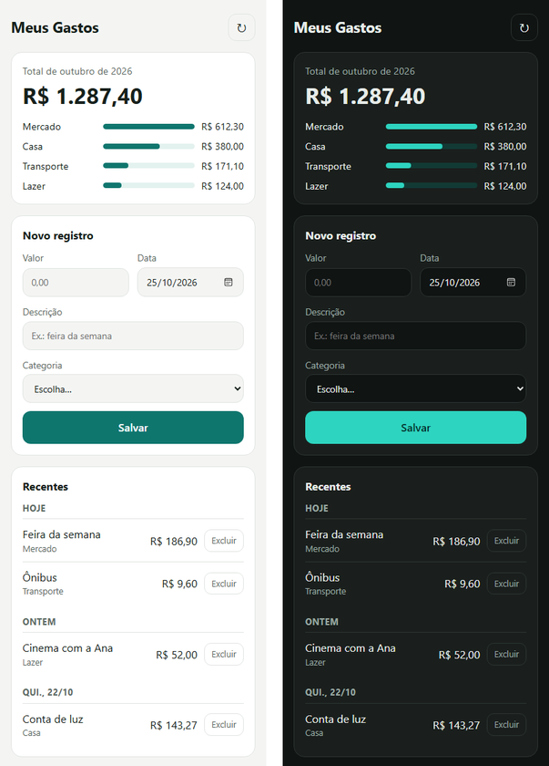

# Apps na planilha

Uma skill para agentes de IA criarem pequenos apps pessoais em cima do Google Planilhas e do Google Apps Script. Não precisa de servidor, cartão de crédito nem de instalar nada: o app roda na sua conta Google, de graça. Ela foi pensada para quem se vira bem com software, mas não programa.

Funciona no **Claude**, no **Codex**, no **opencode** e no **Antigravity**, porque segue o padrão aberto de Agent Skills: uma pasta com um arquivo `SKILL.md`.

<p align="center"></p>

## O que ela faz

- **Escolhe o formato mais simples que resolve:** uma planilha com automações (lembretes por e-mail, caixas de seleção que funcionam no celular), um formulário que alimenta a planilha ou um app da Web que abre no celular como se fosse um app.
- **Escreve o código a partir de um núcleo fixo e testado.** As proteções de segurança moram nesse núcleo, que é igual em todo app. A cada app, o agente escreve só a parte que muda.
- **Conduz a instalação clique a clique**, do "Extensões > Apps Script" até o ícone na tela do celular.
- **Explica os riscos em linguagem simples:** o que é a tela "O Google não verificou este app", o que cada permissão significa, por que não compartilhar a planilha.
- **Ajuda a ligar uma IA aos dados**, com tarefas agendadas do Gemini, do ChatGPT ou do Claude que comentam o que está acontecendo.

## Como instalar

| Ferramenta | Pasta da skill |
|---|---|
| Claude (claude.ai e app) | enviada nas configurações, seção Skills |
| Claude Code | `~/.claude/skills/apps-na-planilha` |
| Codex (terminal, extensão e app) | `~/.agents/skills/apps-na-planilha` |
| opencode | `~/.agents/skills/apps-na-planilha` (a mesma do Codex) |
| Antigravity (app, editor e terminal) | `~/.gemini/config/skills/apps-na-planilha` |

**Claude (claude.ai ou app do Claude):** baixe `apps-na-planilha.skill` na [página de versões](https://github.com/casanovadiogo-cell/apps-na-planilha/releases/latest) e envie nas configurações do Claude, na seção **Skills**. É preciso estar com a execução de código ligada.

**Com git**, um comando para a sua ferramenta:

```bash
# Claude Code
git clone https://github.com/casanovadiogo-cell/apps-na-planilha ~/.claude/skills/apps-na-planilha

# Codex e opencode (a mesma pasta serve para os dois)
git clone https://github.com/casanovadiogo-cell/apps-na-planilha ~/.agents/skills/apps-na-planilha

# Antigravity
git clone https://github.com/casanovadiogo-cell/apps-na-planilha ~/.gemini/config/skills/apps-na-planilha
```

No PowerShell do Windows, use `$HOME` no lugar de `~`, por exemplo `"$HOME\.agents\skills\apps-na-planilha"`.

**Sem git:** baixe `apps-na-planilha.zip` na [página de versões](https://github.com/casanovadiogo-cell/apps-na-planilha/releases/latest) e extraia dentro da pasta de skills da sua ferramenta (a da tabela, sem o `apps-na-planilha` do fim). O zip já traz a pasta `apps-na-planilha`.

Depois de instalar, reinicie a ferramenta. No Codex dá para chamar a skill com `$apps-na-planilha`; nas outras, basta pedir. Algumas observações:

- **Só num projeto:** use a pasta `.agents/skills/apps-na-planilha` dentro do projeto (Codex, opencode e Antigravity) ou `.claude/skills/apps-na-planilha` (Claude Code).
- **opencode e Claude Code juntos:** o opencode também lê `~/.claude/skills`. Se você já instalou para o Claude Code, ele já encontra a skill.
- **Atualizar** quem instalou com git: `git -C ~/.agents/skills/apps-na-planilha pull` (troque pela pasta que você usou).

Depois é só pedir, do seu jeito. Por exemplo:

- "Quero um app no celular para lançar meus gastos e ver quanto ainda tenho livre no mês."
- "Faz uma caderneta do meu cachorro que me avise por e-mail quando a vacina estiver chegando."
- "Quero um bingo para jogar com os colegas, cada um no seu celular."

## Segurança

O código roda com a sua conta Google, então a segurança vem embutida desde o primeiro arquivo:

- Por padrão, o app só abre para o dono, e cada ação confere isso de novo no servidor.
- Texto digitado nunca vira fórmula na planilha, e dado da planilha nunca vira código na tela.
- Nenhum ID, e-mail ou chave fica escrito no código, que pode ser compartilhado sem expor nada.
- O app pede só as permissões que usa. A skill explica cada uma antes da autorização.
- Um verificador automático (`scripts/revisar_seguranca.py`) revisa o código antes de cada entrega e confere se os arquivos fixos estão intactos.

Achou um problema de segurança? Abra uma issue descrevendo o problema, sem incluir dados pessoais nem links das suas planilhas.

## O que tem aqui

```
SKILL.md                  instruções que o agente segue
references/               guias: formatos, arquitetura, instalação, segurança,
                          automações, apps em grupo, IA agendada, modo avançado
assets/nucleo/            arquivos fixos e testados (Nucleo.gs, Tarefas.gs, base.html)
assets/app-web/           ponto de partida de um app da Web
assets/planilha/          ponto de partida de uma planilha com automações
scripts/revisar_seguranca.py   verificador de segurança
LICENSE                   licença MIT
```

## Quando não usar

Apps Script é ótimo para uso pessoal e para grupos pequenos. Para app público, para clientes, com pagamento, com dados sensíveis de outras pessoas ou com muita gente ao mesmo tempo, procure uma hospedagem de verdade. A própria skill avisa quando a ideia não cabe aqui.

## Licença

[MIT](LICENSE): pode usar, copiar, adaptar e redistribuir, desde que mantenha o aviso de autoria.
